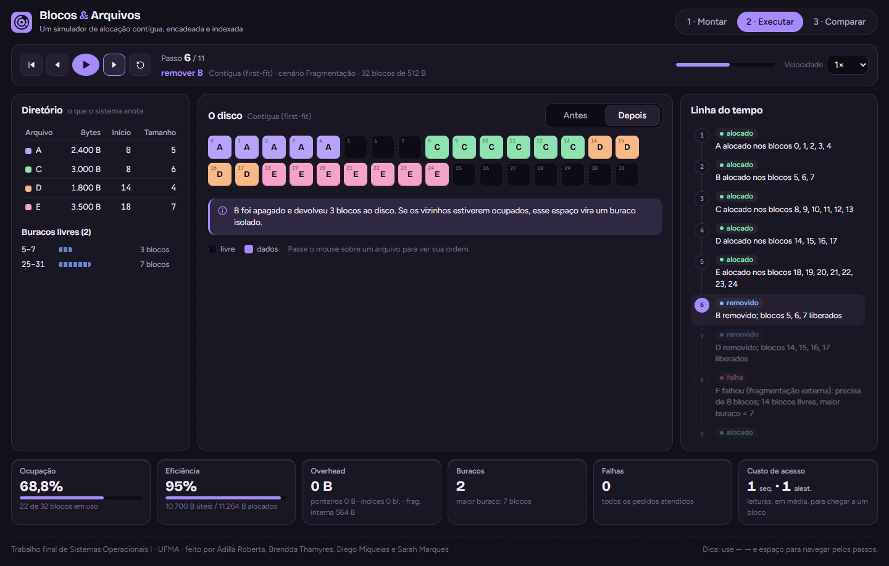
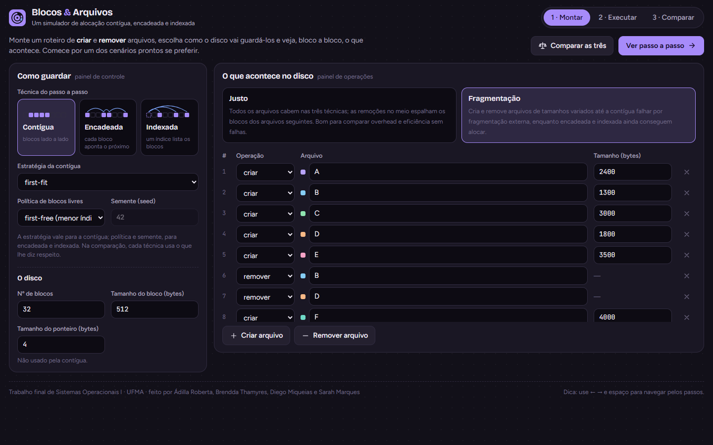
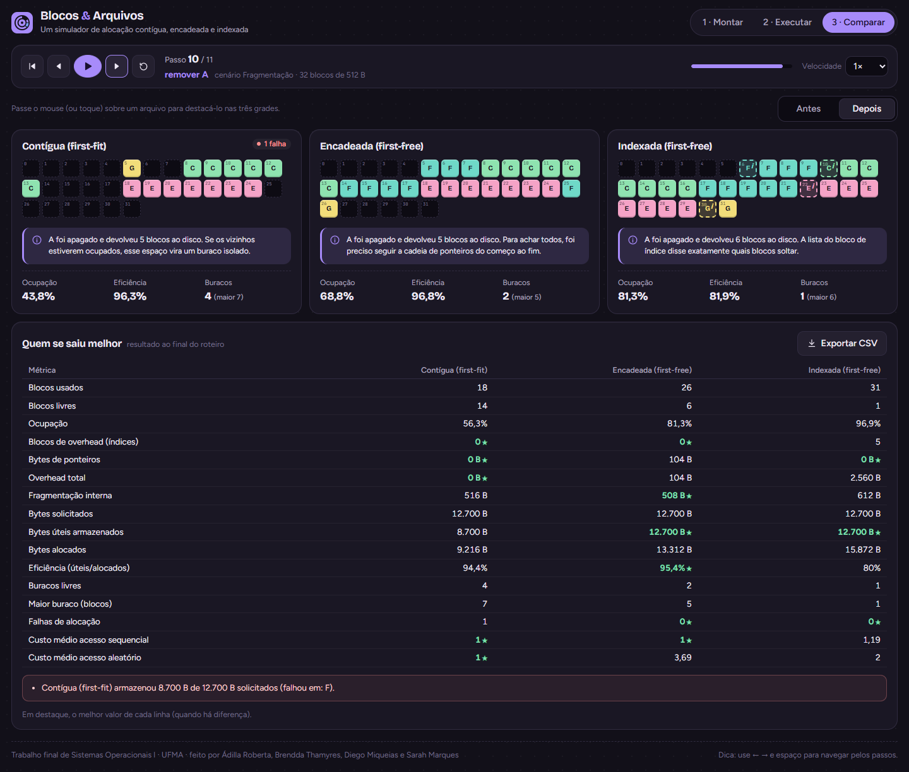
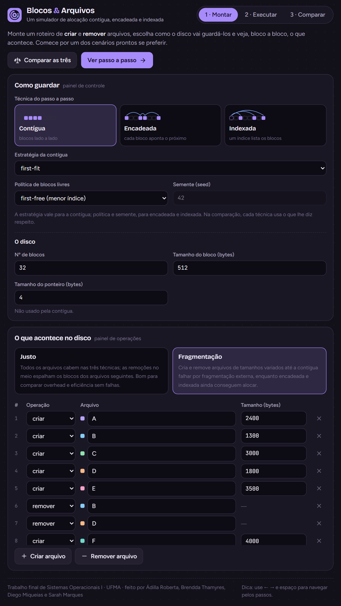
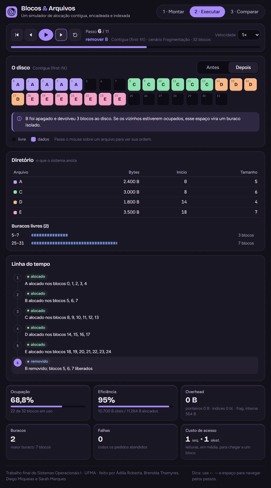
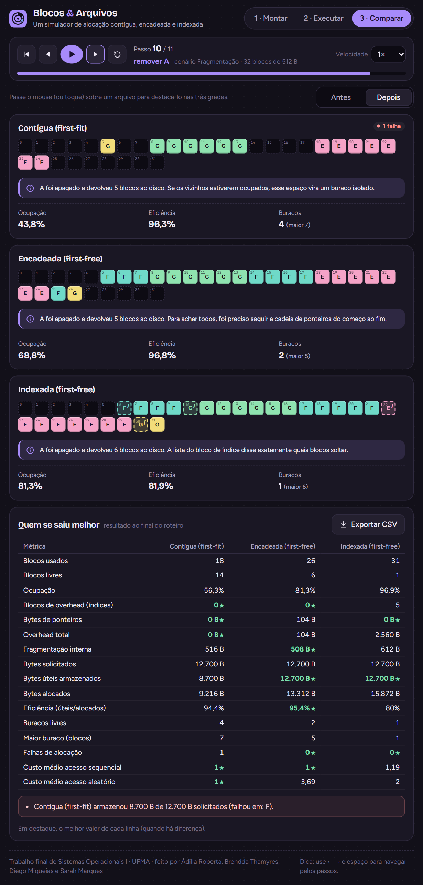
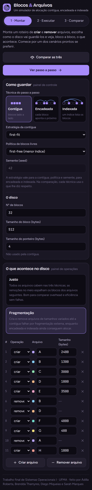
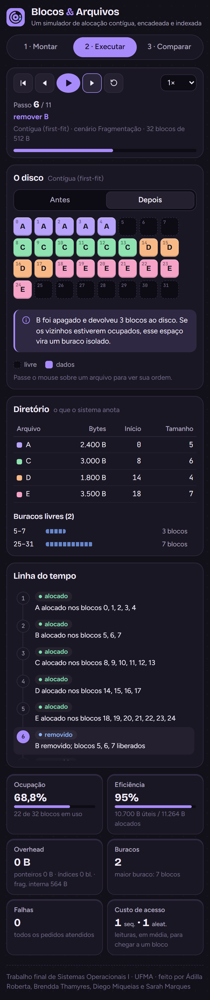
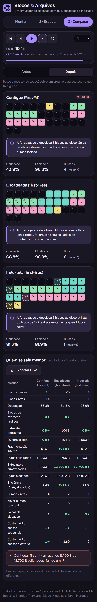
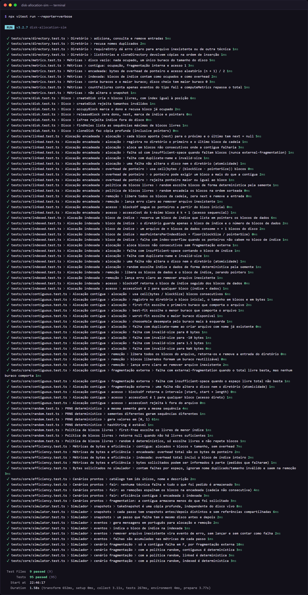

# Simulador de Alocação de Arquivos em Disco

Trabalho final de **Sistemas Operacionais I — UFMA**.



## Objetivo

Simular, de forma visual e interativa, as três técnicas clássicas de alocação de arquivos
em disco e comparar seu comportamento:

- **Contígua** — cada arquivo ocupa blocos consecutivos (estratégias _first-fit_,
  _best-fit_ e _worst-fit_). Acesso direto rápido, mas sofre **fragmentação externa**.
- **Encadeada** — cada bloco guarda um ponteiro para o próximo. Sem fragmentação externa,
  mas com **overhead de ponteiro** em todo bloco e acesso apenas sequencial.
- **Indexada** — cada arquivo tem um **bloco de índice** com a lista dos seus blocos.
  Acesso direto sem fragmentação externa, ao custo de um bloco extra por arquivo.

O simulador executa um roteiro de operações (criar/remover arquivos), mostra o disco e o
diretório antes e depois de cada passo, registra um log de eventos e calcula métricas
(ocupação, eficiência, overhead, número de buracos, maior buraco, falhas e custo de acesso).
A interface é inspirada visualmente no [SOPlay](https://soplay.vercel.app).

## Como rodar

Requer Node.js 20+.

```bash
npm i            # instala as dependências
npm run dev      # sobe a interface web (Vite)
npm run cli      # roda um cenário no terminal e imprime o disco em texto
npm test         # roda os testes (Vitest)
```

A CLI imprime o disco antes/depois de cada operação (`[  ]` livre, `[A ]` dados,
`[A→]` dados com ponteiro, `[iA]` bloco de índice), seguido das métricas. Aceita a
técnica, a estratégia da contígua, o cenário, a política de blocos livres e a semente:

```bash
npm run cli -- contiguous best-fit
npm run cli -- linked --policy random --seed 7
npm run cli -- indexed --scenario fair
npm run cli -- --compare                    # ao final, tabela comparativa das 3 técnicas
npm run cli -- --scenario fair --compare
```

`--scenario` aceita `fair` ou `fragmentation` (padrão: `fragmentation`). Na tabela do
`--compare`, se alguma técnica falhou, aparece a nota
"armazenou X B de Y B solicitados".

## Cenários prontos

Ficam em `src/scenarios/` e são listados em `scenarios` (`src/scenarios/index.ts`), com
`id`, nome e descrição. A interface os oferece no Painel de Operações e a CLI os aceita
em `--scenario`. Os dois usam um disco de 32 blocos de 512 bytes.

| id              | Nome         | O que mostra                                                                                                                                                                     |
| --------------- | ------------ | -------------------------------------------------------------------------------------------------------------------------------------------------------------------------------- |
| `fair`          | Justo        | Todos os arquivos cabem nas três técnicas. As remoções no meio espalham os blocos dos arquivos seguintes (na encadeada e na indexada). Compara overhead e eficiência sem falhas. |
| `fragmentation` | Fragmentação | Abre buracos até a contígua falhar por **fragmentação externa** (F precisa de 8 blocos, há 14 livres, mas o maior buraco tem 7), enquanto encadeada e indexada ainda alocam.     |

## Métricas

Calculadas por `computeMetrics` (`src/core/metrics.ts`) a cada passo:

- **Ocupação**: blocos usados / total de blocos.
- **Bytes solicitados**: soma dos arquivos que o roteiro pede que existam no momento
  (inclusive os que falharam por falta de espaço); **bytes úteis armazenados**: soma dos
  arquivos que de fato estão no diretório; **bytes alocados**: blocos usados × tamanho
  do bloco.
- **Eficiência**: bytes úteis / bytes alocados. No cenário `fair`, contígua ≥ encadeada
  ≥ indexada.
- **Overhead total em bytes**: ponteiros da encadeada + blocos de índice × tamanho do
  bloco. Também são mostrados os bytes de ponteiro e a fragmentação interna.
- **Buracos** e **maior buraco**, **falhas de alocação** e **custo médio de acesso**
  sequencial e aleatório (leituras por bloco de dados).

## Interface

`npm run dev` abre a interface (tema escuro, inspirada no SOPlay). Ela foi pensada para
caber numa tela de 1366×768, se adapta a tablets e celulares (ver [Prints](#prints)) e
tem três páginas:

- **Configuração**: no Painel de Controle ficam a técnica (contígua com a estratégia,
  encadeada ou indexada), a política de blocos livres, a semente (quando a política é
  `random`), o nº de blocos e os tamanhos do bloco e do ponteiro. No Painel de Operações
  você escolhe um cenário pronto ou edita o roteiro: criar (nome e bytes) e remover
  (nome), adicionando ou removendo linhas. Os botões **Executar** e **Comparar técnicas**
  abrem as outras páginas.
- **Execução**: no topo fica o player (início, passo anterior, play/pause, próximo
  passo, reiniciar, velocidade e "passo i / n"). Os atalhos são ← → e espaço. No centro
  fica o disco, com um toggle para ver o estado **antes** ou **depois** da operação; os
  blocos recém-alocados ou liberados piscam. Ao passar o mouse sobre um arquivo, os
  blocos dele ganham destaque e numeração: na encadeada aparecem setas da cadeia, e na
  indexada setas saem do bloco de índice (borda tracejada + "i"). À esquerda ficam o
  diretório, com as colunas da técnica, e os buracos livres. À direita fica a linha do
  tempo de eventos, com chips alocado/removido/falha/erro; clicar em um evento leva ao
  passo dele. No rodapé ficam os cards de métricas.
- **Comparação**: os três discos lado a lado com o mesmo cenário e um único player. Abaixo
  vem a tabela comparativa final (`runComparison`), com as notas de falha e o botão
  **Exportar CSV**, que gera um arquivo com `;` e vírgula decimal, pronto para o
  relatório.

Em todas as páginas que mostram passos há um **narrador**: uma caixa que explica em
português simples o que aconteceu e por quê. Ele está em `src/ui/narration.ts` e usa
apenas os eventos e snapshots do core.

### Prints

Todos no cenário **Fragmentação**. Os arquivos ficam em `docs/relatorio/prints/`.

**Computador (1440px)**

| 1 · Montar                                                           | 2 · Executar                                                       | 3 · Comparar                                                         |
| -------------------------------------------------------------------- | ------------------------------------------------------------------ | -------------------------------------------------------------------- |
|  |  |  |

**Tablet (820px)**

| 1 · Montar                                                                                     | 2 · Executar                                                                                 | 3 · Comparar                                                                                   |
| ---------------------------------------------------------------------------------------------- | -------------------------------------------------------------------------------------------- | ---------------------------------------------------------------------------------------------- |
|  |  |  |

**Celular (390px)**

| 1 · Montar                                                                                       | 2 · Executar                                                                                   | 3 · Comparar                                                                                     |
| ------------------------------------------------------------------------------------------------ | ---------------------------------------------------------------------------------------------- | ------------------------------------------------------------------------------------------------ |
|  |  |  |

### Identidade visual

O nome na interface é **Blocos & Arquivos**. As fontes são Bricolage Grotesque nos
títulos, Figtree no texto e JetBrains Mono nos números; elas vêm do `@fontsource` e são
embutidas no build, então funcionam offline no laboratório. A paleta dos arquivos foi
escolhida à mão (`src/ui/format.ts`), os ícones são SVGs próprios
(`src/ui/components/Icon.tsx`) e as cores ficam em variáveis no topo de
`src/ui/styles.css`. Para pôr os nomes da equipe no rodapé, preencha `team` em
`src/ui/credits.ts`.

A UI não reimplementa regras de alocação. O hook `useSimulation(config, ops)` chama
`runScenario` do core e expõe o snapshot do passo atual e os controles do player.
`useComparison` faz o mesmo com `runComparison`.

Outros scripts: `npm run build`, `npm run lint`, `npm run format`.

## Testes

Os testes ficam em `tests/core/` (Vitest) e cobrem só o core: `npm test` roda os 95.



<details>
<summary>Prints de cada arquivo de teste</summary>

| Arquivo              | O que testa                                           | Print                                                                     |
| -------------------- | ----------------------------------------------------- | ------------------------------------------------------------------------- |
| `contiguous.test.ts` | alocação contígua, estratégias e fragmentação externa | [teste-contiguous.png](docs/relatorio/prints/testes/teste-contiguous.png) |
| `linked.test.ts`     | alocação encadeada e overhead de ponteiro             | [teste-linked.png](docs/relatorio/prints/testes/teste-linked.png)         |
| `indexed.test.ts`    | alocação indexada e bloco de índice                   | [teste-indexed.png](docs/relatorio/prints/testes/teste-indexed.png)       |
| `simulator.test.ts`  | snapshots, eventos e cenário de fragmentação          | [teste-simulator.png](docs/relatorio/prints/testes/teste-simulator.png)   |
| `efficiency.test.ts` | bytes, eficiência e cenários prontos                  | [teste-efficiency.png](docs/relatorio/prints/testes/teste-efficiency.png) |
| `disk.test.ts`       | disco                                                 | [teste-disk.png](docs/relatorio/prints/testes/teste-disk.png)             |
| `metrics.test.ts`    | métricas                                              | [teste-metrics.png](docs/relatorio/prints/testes/teste-metrics.png)       |
| `random.test.ts`     | sorteio com semente e política de blocos livres       | [teste-random.png](docs/relatorio/prints/testes/teste-random.png)         |
| `directory.test.ts`  | diretório                                             | [teste-directory.png](docs/relatorio/prints/testes/teste-directory.png)   |

</details>

## Arquitetura

A lógica de alocação fica em `src/core/`, em **TypeScript puro**, sem depender de React
nem do DOM. A interface apenas consome o core, e a CLI usa o mesmo core pelo terminal.
Essa regra é verificada automaticamente:

- `tsconfig.core.json` compila `src/core`, `src/scenarios` e `cli` **sem** a lib DOM
  (faz parte do `npm run build`);
- o ESLint proíbe importar `react` ou `src/ui` dentro de `src/core`.

## Mapa das pastas

```
src/
  core/                 # núcleo puro (sem React/DOM)
    types.ts            # Block, Disk, FileEntry, AllocationResult, SimulationEvent, Snapshot...
    disk.ts             # createDisk(n, blockSize): disco como array de blocos em memória
    directory.ts        # diretório: nome do arquivo -> metadados da técnica
    allocators/
      allocator.ts      # interface comum Allocator
      contiguous.ts     # contígua (first-fit, best-fit, worst-fit)
      linked.ts         # encadeada (ponteiro para o próximo bloco)
      indexed.ts        # indexada (bloco de índice)
    metrics.ts          # ocupação, overhead, buracos, maior buraco, falhas, custo de acesso
    simulator.ts        # executa um roteiro, gera snapshots antes/depois e log de eventos
    index.ts            # API pública do core
  scenarios/
    index.ts            # lista `scenarios` (id, nome, descrição) e findScenario
    fair.ts             # cenário "Justo": nada falha, blocos espalhados
    fragmentation.ts    # cenário "Fragmentação": contígua falha por fragmentação externa
  ui/
    config.ts           # SimConfig, validação do formulário e conversão para o core
    hooks/              # usePlayer, useSimulation, useComparison
    components/         # DiskGrid, DirectoryTable, EventLog, MetricsCards, PlayerControls
    pages/              # ConfigPage, ExecutionPage, ComparisonPage
    comparisonTable.ts  # linhas da tabela comparativa, notas de falha e CSV
    styles.css          # tema (variáveis CSS)
  App.tsx
  main.tsx
cli/
  run.ts                # roda um cenário no terminal (fallback para os prints)
tests/
  core/                 # um arquivo de teste por módulo + eficiência e cenários
docs/
  relatorio/
    prints/             # capturas da interface (pc, tablet, celular)
      testes/           # saída do Vitest para cada arquivo de teste
```

## Divisão da equipe

| Frente | Responsabilidade                     | Arquivos principais                                                                                   |
| ------ | ------------------------------------ | ----------------------------------------------------------------------------------------------------- |
| 1      | Disco, diretório, contígua e remoção | `core/disk.ts`, `core/directory.ts`, `core/allocators/contiguous.ts`, `tests/core/contiguous.test.ts` |
| 2      | Encadeada, indexada e métricas       | `core/allocators/linked.ts`, `core/allocators/indexed.ts`, `core/metrics.ts`, testes correspondentes  |
| 3      | Interface, cenários e relatório      | `src/ui/`, `src/scenarios/`, `core/simulator.ts`, `cli/run.ts`, `docs/relatorio/`                     |

Cada frente trabalha contra os contratos de `core/types.ts` e `core/allocators/allocator.ts`.
Os testes em `tests/core/` descrevem o comportamento esperado de cada módulo.
